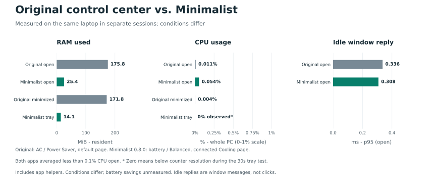

# Minimalist Control Center

A lightweight Windows control center for **Tongfang GK5CN6Z** laptops.

I built this because the original control center felt sluggish, used too much RAM, and kept turning the light bar on. I wanted a small tool with the controls I actually use.

**[Download for Windows 11 (x64)](https://github.com/Tlamir/MinimalistControlCenter/releases/latest/download/mcc-windows-x64-installer.zip)** | [All releases](https://github.com/Tlamir/MinimalistControlCenter/releases)

## Install

1. Exit the original control center and any older Minimalist app, including their tray icons.
2. Download the ZIP above, right-click it and choose **Extract All**, then open the extracted folder.
3. Double-click **Install.cmd**, accept the administrator prompt, and open the desktop shortcut.

Starts in the tray with Windows and turns the light bar off after sign-in. No repeated administrator prompts. Close hides the window; **Exit** quits. Remove it through Windows **Settings > Apps > Installed apps**.

## Controls

- **Cooling:** Automatic / Boost fans; Office, Balanced and Performance power presets; save your own combination.
- **Lighting:** keyboard effects, brightness and color; light-bar switch.
- **Monitoring:** CPU usage and clock, RAM and battery; GPU clock, temperature and available fan readings on demand.

Office uses automatic cooling with Power Saver. Custom fan curves and the OEM minimum-speed mode are not available.

## Performance

Uses **25.4 MiB open / 14.1 MiB in the tray**, including its helper. The original app measured **175.8 MiB open / 171.8 MiB minimized**. Background polling stops when hidden.

Both averaged **less than 0.1% CPU open**. Hidden CPU measured **0% observed** for Minimalist and **0.004%** for the original; zero means below measurement resolution.

Same laptop, different power settings and pages. These measurements show memory use, CPU activity and idle window replies; they do not establish faster controls or longer battery life. [Results and method](docs/BENCHMARKS.md).

## Laptops

The GK5CN6Z platform also appears in the [XMG NEO 15 (M18)](https://download.schenker-tech.de/package/xmg_neo15xne15m18/). **Hardware controls currently support the tested Monster Tulpar T5 V17.1, BIOS N.1.06.** Other Tongfang/XMG firmware variants need validation; unrecognized hardware stays read-only.

Keep the original app installed for now, with its startup disabled. OEM uninstall and full feature replacement have not been verified.

[Build from source](docs/BUILD.md) | [Fan support](docs/FAN_SUPPORT.md) | [Report a problem](https://github.com/Tlamir/MinimalistControlCenter/issues) | [MIT license](LICENSE)
