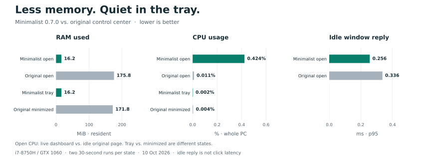

# Benchmarks


| App / state | RAM, resident | Private commit | CPU, whole PC | Idle reply, p95 |
|---|---:|---:|---:|---:|
| Minimalist 0.7.2 · open | 14.0 MiB | 2.3 MiB | 0.424–0.506% | 0.195–0.356 ms |
| Minimalist 0.8.0 · open | 25.4 MiB | 4.3 MiB | 0.034–0.073% | 0.289–0.328 ms |
| Minimalist 0.7.2 · tray | 14.0 MiB | 2.3 MiB | 0% observed | — |
| Minimalist 0.8.0 · tray | 14.1 MiB | 2.3 MiB | 0% observed | — |

Open CPU averaged **0.465% → 0.054%**, an **88% reduction**. Child launches dropped from 20 to zero per 30-second interval after settling. The read-only helper adds about 11 MiB while Cooling is open, then exits on hide or page change. Idle reply averaged 0.275 → 0.308 ms; this does not establish faster clicks.

## Method

Same Monster Tulpar T5 V17.1 / N.1.06, i7-8750H, GTX 1060, 16 GB RAM, 12 logical processors; Windows 25H2 build 26200.9457. Battery power, Balanced, normal desktop activity. No build or stress test ran during measurement. One version ran at a time, on its connected Cooling page. Each had two 30-second open runs and one 30-second tray run after settling. Power source was checked before each open run and after each version; power plan and firmware fan/light-bar state stayed unchanged. No hardware writes were issued.

- **RAM:** mean of per-run median aggregate working sets, sampled once a second. Shared pages can count twice; short helper peaks can be missed.
- **CPU:** aggregate process time / elapsed time / 12 logical processors. GUI and transient children, including exited helpers, use Windows job accounting. The existing 0.8.0 observer is included separately through process deltas and sampled memory. Shared WMI/Windows/driver hosts and the benchmark process are excluded. Zero means below counter resolution.
- **Response:** mean of each run's p95 idle `WM_NULL` reply time. No timeouts. This measures message dispatch, not control actions, frame rate or intermittent hiccups.

The comparison includes slower fan-state refresh (five seconds instead of two), connection reuse and fewer wakeups. User changes still apply immediately through fresh checks. It does not measure cold-boot success, battery runtime or cooling performance.

[JSON report](../reports/benchmarks/v0.8.0-2026-10-11.json) contains hashes, per-run measurements and observer lifecycle checks. [Measurement script](../scripts/measure-app.ps1) · [Chart script](../scripts/plot_benchmarks.py).

## Earlier original-app comparison



The original app used 175.8 MiB open and 171.8 MiB minimized. Minimalist 0.7.0 used 16.2 MiB; its open CPU was higher than the original's idle default page. This older test used **AC / Power Saver**, two 30-second runs per state, and included the original GUI, tray and launcher service. It is not a matched comparison against 0.8.0. [Earlier raw data](../reports/benchmarks/v0.7.0-2026-10-10.json).

## Repeat

Run a connected app, settle it, then measure its GUI PID in elevated PowerShell. For 0.8.0 open Cooling, include its existing `mcc.exe hardware observe-loop` child with `-ExternalProcessIds`; verify its parent PID and executable path. Do not assign that helper's kill-on-close job to the GUI.

```powershell
.\scripts\measure-app.ps1 -ProcessIds @(GUI_PID) -ExternalProcessIds @(OBSERVER_PID) -Label native-visible -Seconds 30 -WindowHandle WINDOW_HANDLE -Output reports/local/native-visible.json
```

Repeat twice while open. Hide the app, verify the observer exits, then measure the tray without an external PID or window handle. Keep the same power source and plan. The script changes no hardware settings and leaves the app running.
